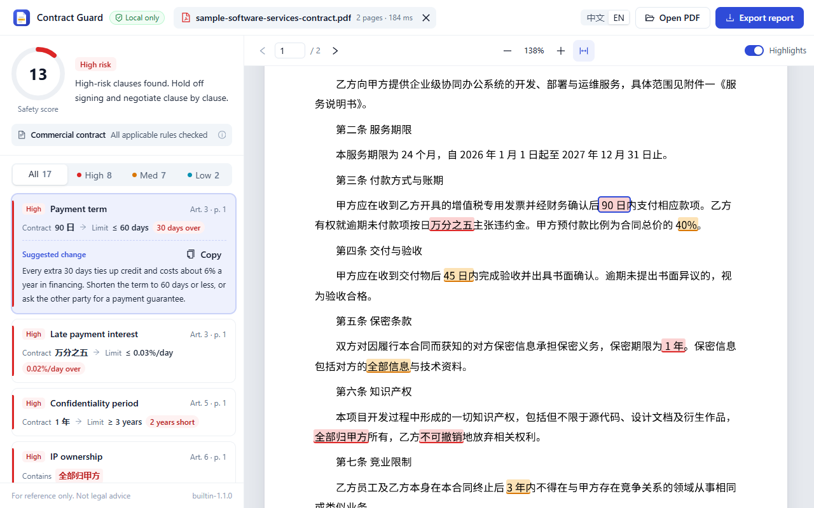

# Contract Guard

[简体中文](README.md) | [Contributing](CONTRIBUTING.md) | [MIT License](LICENSE)

A browser extension that checks Chinese contracts locally. Open a text-based PDF to compare its clauses against built-in rules, navigate findings in the original document, and export a printable HTML report.

> This is an assistive tool, not legal advice. Results can contain false positives or miss relevant issues; a qualified reviewer should assess the contract and its context.



## Features

- Local PDF parsing and deterministic rule evaluation, with no application server or account.
- Twenty built-in Chinese-language rules covering payment, penalties, confidentiality, intellectual property and missing clauses.
- Document-type detection and rule gating for commercial agreements, employment contracts, NDAs and commitments.
- PDF highlights, severity filters, suggested edits and a self-contained HTML report.
- Chinese and English interface and report text. **The rules themselves currently match Chinese clauses only.**
- A synthetic sample PDF for trying the extension without using an actual contract.

## Requirements

- Node.js **24.x** and pnpm **11.x**. The project was verified with Node.js `24.14.1` and pnpm `11.24.0`.
- Google Chrome or Microsoft Edge with Manifest V3 extension support.
- Internet access to install dependencies. The contract-checking workflow itself has no application backend.

Install pnpm if needed:

```bash
npm install -g pnpm@11
```

## Install from source

Download the repository from GitHub, or clone it using the URL shown on the repository page. Open a terminal in the project root and run:

```bash
pnpm install --frozen-lockfile
pnpm build
```

Then load `apps/extension/.output/chrome-mv3` as an unpacked extension:

1. Open `chrome://extensions` in Chrome or `edge://extensions` in Edge.
2. Turn on **Developer mode**.
3. Select **Load unpacked** and choose the `chrome-mv3` directory above.
4. Open the review page from the extension icon if it does not open automatically.

After changing the code, run `pnpm build` again and reload the extension on the browser's extensions page.

## Use

1. Drop a PDF into the review page, click to select one, or use **Ctrl/⌘ + O**. You can also open the built-in sample.
2. Review the detected document type and findings. Selecting a finding navigates to its location when a matching passage exists.
3. Filter by severity, copy suggested changes, and switch the interface language as needed.
4. Select **Export report** to download an HTML file that can be opened or printed in a browser.

Exported reports can contain the file name, contract excerpts and review results. Treat them as confidential when saving or sharing them.

## Privacy and permissions

The extension parses the selected PDF and evaluates rules in the browser. The current implementation has no contract-upload API and declares no `host_permissions`; its `storage` permission is used to save the interface language preference. Exporting a report creates a local HTML download.

The repository includes synthetic examples only. Do not submit actual contracts, personal data, credentials or other confidential material in issues or pull requests.

## Limitations

- Only PDFs with a text layer are supported. Scanned PDFs need to be converted to searchable PDFs with an external OCR tool first.
- Password-protected PDFs must be unlocked first; Word files must first be saved as PDF.
- Built-in rules match Chinese, even when the interface is set to English. Document type detection depends on title keywords near the beginning of the document.
- Default thresholds are general examples. There is no rule editor or rule-package import in the current UI.
- The engine does not understand every contractual context or know which party you represent. It can miss issues or raise false alarms.
- Results on synthetic fixtures do not establish accuracy on real-world contracts.

## Development

```bash
pnpm dev         # Extension development mode
pnpm test        # Rule engine, PDF and UI-logic tests
pnpm typecheck   # TypeScript checks
pnpm build       # Build the Chrome/Edge extension
pnpm test:e2e    # Browser smoke test; run pnpm build first
pnpm zip         # Package the extension as a ZIP
pnpm verify      # Tests, typecheck, build and browser smoke test
```

The browser smoke test looks for Windows Edge/Chrome paths. On another system, set `CG_BROWSER_PATH` to a Chromium executable or install Playwright's Chromium. `pnpm preview` is a helper designed primarily for Windows.

```text
apps/extension/              Extension, UI, PDF parsing and report export
packages/core/               Rules, clause parsing, scoring and translations
packages/core/test/corpus/   Synthetic contracts and expected findings
test/fixtures/               Synthetic PDF and HTML fixtures
scripts/                     Local icon and preview utilities
```

The core package is currently a private TypeScript workspace package, not a published npm package. See [architecture notes](docs/architecture.md) for the data flow.

## License and contributions

Project code is available under the [MIT License](LICENSE). Third-party components have their own licenses; see [third-party notices](THIRD_PARTY_NOTICES.md). Please read [CONTRIBUTING.md](CONTRIBUTING.md) before opening a pull request. For security issues, see [SECURITY.md](SECURITY.md).
