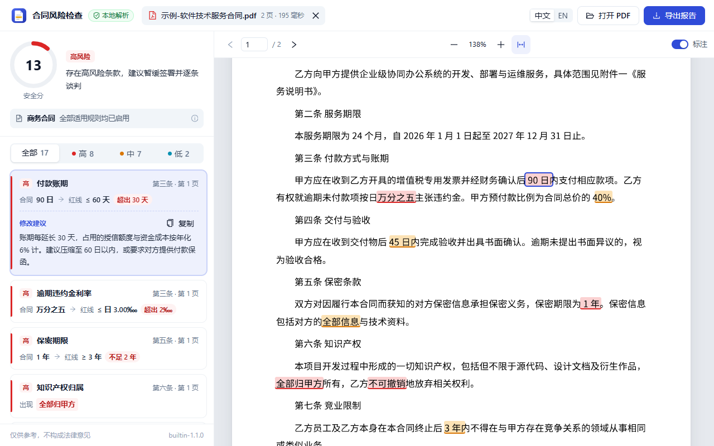

# 合同风险检查助手 · Contract Guard

[English](README.en.md) | [贡献指南](CONTRIBUTING.md) | [MIT 许可证](LICENSE)

一个在浏览器本地运行的合同审查辅助工具。将有文字层的中文合同 PDF 拖入扩展，程序会按内置规则检查条款，在原文中定位风险，并生成可保存、打印的 HTML 报告。

> 本工具提供规则比对结果和修改建议，不构成法律意见。请结合合同背景与专业法律判断复核；没有发现风险也不代表合同没有风险。



## 主要功能

- **本地检查**：PDF 解析、文本提取和规则比对在浏览器中完成，无业务后端，无需账号。
- **规则与定位**：内置 20 条中文规则，覆盖付款账期、违约金、保密、知识产权和必备条款等；可从风险清单跳转到 PDF 原文。
- **识别文书类型**：区分商务合同、雇佣合同、保密协议与承诺/责任书，减少不适用规则的提示；无法识别时会提示用户。
- **报告与界面**：按风险等级筛选、复制修改建议，导出自包含的 HTML 报告；界面和报告支持中文、英文。
- **内置仿真样本**：不需要准备合同即可试用。仓库中的演示和回归样本均用于测试，不代表真实交易。

## 快速开始

### 环境要求

- **Node.js 24.x** 和 **pnpm 11.x**。本次开发验证使用 Node.js `24.14.1`、pnpm `11.24.0`。
- 支持 Manifest V3 扩展的 **Google Chrome** 或 **Microsoft Edge**。
- 安装依赖时需要联网；构建完成后，本地合同解析不需要后端服务。

如果尚未安装 pnpm，可先安装 Node.js，然后执行：

```bash
npm install -g pnpm@11
```

### 1. 获取源码并构建

从 GitHub 仓库的 **Code → Download ZIP** 下载并解压，或复制仓库地址使用 `git clone`。在终端进入解压后的项目目录：

```bash
pnpm install --frozen-lockfile
pnpm build
```

构建后的扩展目录：

```text
apps/extension/.output/chrome-mv3
```

> 请在项目根目录执行上述命令。源码仓库地址以 GitHub 仓库页面显示的实际地址为准。

### 2. 加载到浏览器

1. 在 Chrome 打开 `chrome://extensions`，或在 Edge 打开 `edge://extensions`。
2. 开启右上角的**开发者模式**。
3. 点击**加载已解压的扩展程序**，选择上一步的 `apps/extension/.output/chrome-mv3` 目录。
4. 安装后会打开审查页；也可以点击浏览器工具栏中的扩展图标，再选择**打开审查页**。

代码更新后重新执行 `pnpm build`，再回到扩展管理页点击该扩展的刷新图标。

### 3. 检查合同

1. 将 PDF 拖到审查页，或点击选择文件；也可使用 **Ctrl/⌘ + O**。
2. 手边没有合同，可以点击**用示例合同试试**。
3. 在左侧查看检查摘要和风险清单，点击风险项可定位到右侧 PDF；缺失条款没有具体原文位置。
4. 按需切换风险等级、查看建议或复制建议；右上角可切换中文/英文。
5. 点击**导出报告**，下载 HTML 文件；可在浏览器打开并打印。

导出报告可能包含合同文件名和原文摘录，请按合同的保密要求保存和分享。

## 内置规则如何使用

内置规则是供试用的通用参考值，不代表任何公司的实际审批标准。当前扩展界面尚不支持编辑、导入企业规则；开发者可在 [`packages/core/src/rules/built-in.ts`](packages/core/src/rules/built-in.ts) 查看规则。

| 类别 | 默认检查示例 |
|---|---|
| 数值阈值 | 付款账期不超过 60 天、预付款不超过 30%、违约金总额不超过合同额的 10% |
| 期限与责任 | 验收不超过 30 天、质保不少于 1 年、保密不少于 3 年、竞业限制不超过 2 年 |
| 表述风险 | 自动续约、单方任意解除、知识产权全部归对方、保密范围过宽 |
| 缺失条款 | 争议解决、不可抗力、发票、数据合规、担保及变更流程等 |

规则是否启用取决于文书类型及触发条件。例如，未涉及预付款时不要求付款担保；未识别类型时会按全部规则检查并提示人工确认。完整规则以源码为准。

## 隐私与权限

- 选取的 PDF 由扩展页面中的 PDF.js 读取并解析；当前实现没有上传合同的业务接口。
- 扩展声明的权限为 `storage`，用于保存界面语言偏好；当前未声明 `host_permissions`。
- 页面不会把合同上传到项目服务器；导出的 HTML 报告由浏览器下载到本地，可能包含文件名、原文摘录和审查结果。
- 仓库内的示例均为仿真材料。提交问题或贡献代码时，请勿上传真实合同、身份证号、联系方式、密钥或其他敏感资料。

## 支持范围与已知限制

- 仅支持带文字层的 PDF。扫描件或图片型 PDF 需先自行使用 OCR 转换为可搜索 PDF。
- 加密 PDF 需先解除打开密码；Word 文件需先另存为 PDF。
- 内置规则面向**中文条款**。英文界面不代表支持英文合同规则识别，非中文文档会给出提示。
- 文书类型依靠文档开头的标题关键词识别，复杂排版和特殊表述可能识别不准。
- 规则不理解合同的全部上下文，也无法判断用户是合同的哪一方；结果可能误报或漏报。
- 随附语料为仿真样本，测试结果不能代表真实业务合同的准确率。生产使用前请结合自身合同和合规要求验证。

## 开发与验证

```bash
pnpm dev         # 扩展开发模式
pnpm test        # 核心规则、PDF 解析、界面纯逻辑等测试
pnpm typecheck   # 核心包和扩展的 TypeScript 类型检查
pnpm build       # 构建 Chrome/Edge 扩展
pnpm test:e2e    # 浏览器端到端检查，需先执行 pnpm build
pnpm zip         # 生成扩展 ZIP 包
pnpm verify      # test + typecheck + build + test:e2e
```

`pnpm test:e2e` 优先查找 Windows 上安装的 Edge/Chrome；其他环境可通过 `CG_BROWSER_PATH` 指向 Chromium 浏览器，或安装 Playwright 的 Chromium。`pnpm preview` 是使用临时浏览器配置打开扩展的辅助命令，当前脚本主要面向 Windows。

项目结构：

```text
apps/extension/              浏览器扩展、界面、PDF 解析和报告导出
packages/core/               条款切分、规则判断、评分与国际化
packages/core/test/corpus/   仿真合同和人工标注的期望结果
test/fixtures/               仿真 PDF、HTML 测试样本
scripts/                     本地图标和预览工具
```

规则数据流和测试边界见 [架构说明](docs/architecture.md)。本项目是 pnpm 工作区，`@contract-guard/core` 当前为内部 TypeScript 源码包，并未作为独立 npm 包发布。

## 常见问题

**扩展加载失败或提示找不到 manifest？** 先执行 `pnpm build`，并选择 `apps/extension/.output/chrome-mv3` 目录，而不是项目根目录或 ZIP 文件。

**提示 PDF 没有文字层？** 这通常是扫描件。请先使用可信的本地 OCR 工具生成可搜索 PDF，再重新打开。

**为什么没有发现项？** 可能确实没有命中当前规则，也可能因为文书类型、文本提取或规则覆盖范围造成漏报。请结合原文人工复核。

**可以修改规则吗？** 当前没有可视化规则编辑器。开发者可修改内置规则源码后运行测试并重新构建；企业规则包导入尚未实现。

## 贡献与许可

欢迎提交改进建议和代码。开始前请阅读 [贡献指南](CONTRIBUTING.md)；安全问题的反馈方式见 [安全说明](SECURITY.md)。

本项目使用 [MIT License](LICENSE)。PDF.js 等第三方组件遵循各自的许可条款，详见 [第三方组件说明](THIRD_PARTY_NOTICES.md)。
